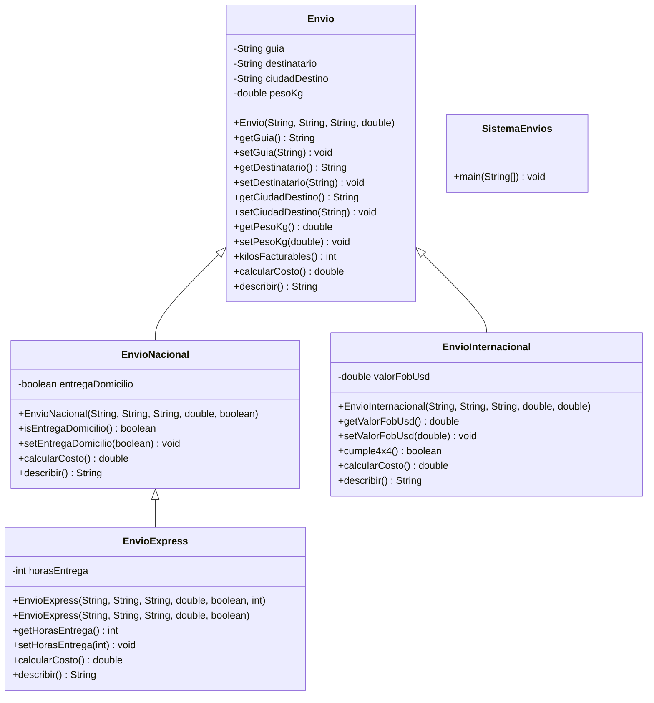

# Escuela Politécnica Nacional - EPN  
# Escuela de Formación de Tecnólogos - ESFOT 
## Sistema de Envíos Servientrega - POO en Java
> Estudiante: Melva Patricia Suarez C.  
> Asignatura: Programación Orientada a Objetos  
> Lenguaje: Java (JDK 21 o superior)  

Este proyecto es una aplicación de consola desarrollada en Java que simula el sistema de gestión de envíos de la empresa Servientrega. Fue creado como solución a la prueba práctica de Programación Orientada a Objetos.

## Características y Funcionalidades
El sistema permite a un empleado de mostrador realizar las siguientes acciones a través de un menú interactivo:
1. **Registrar envío:** Crea envíos de tipo Nacional, Express o Internacional, generando una guía única.
2. **Consultar envío:** Busca un paquete en tránsito usando su número de guía.
3. **Entregar envío:** Retira el paquete de la lista de tránsito y lo mueve al historial de entregados.
4. **Listar entregados:** Muestra todos los envíos entregados y calcula el total recaudado.
5. **Salir:** Cierra el programa.

## 📌 Conceptos de POO Aplicados
- **Encapsulamiento:** Atributos privados con métodos `get` y `set` (con validaciones, como en `setPesoKg`).
- **Herencia multinivel:** `Envio` -> `EnvioNacional` -> `EnvioExpress`. Y `Envio` -> `EnvioInternacional`.
- **Sobrescritura:** Métodos `calcularCosto()` y `describir()` adaptados en cada clase hija.
- **Sobrecarga:** Constructores en `EnvioExpress` (uno con horas y otro con 48 horas por defecto).
- **Polimorfismo:** Uso de colecciones genéricas (`HashMap` y `ArrayList`) para almacenar los diferentes tipos de envíos.
- **Conversiones:** Uso de *casting* a `int` para los kilos facturables y `String.valueOf()` para las guías.

## 📋 Reglas de Negocio Implementadas
- **Guías:** Prefijos `NAC`, `EXP`, `INT` seguidos de un contador global que inicia en `1001`. Si un envío se rechaza, el contador no avanza.
- **Kilos facturables:** Se cobra por kilo completo. Si hay fracción (ej. 2.3 kg), se cobra el siguiente (3 kg).
- **Tarifas:**
    - *Nacional:* $2.00 por kilo + $1.50 si es a domicilio.
    - *Express:* Costo nacional + 40% de recargo.
    - *Internacional:* $6.00 por kilo + $20.00 de arancel.
- **Regla 4x4 (Aduana):** Los envíos internacionales se rechazan si pesan más de 4 kg o superan los $400.00 FOB.

## 🗂️ Estructura del Proyecto
```text
sistemaEnvios-poo/
├── src/
│   ├── Envios/
│   │   ├── Envio.java
│   │   ├── EnvioExpress.java
│   │   ├── EnvioInternacional.java
│   │   └── EnvioNacional.java
│   └── SistemaEnvios.java
├── .gitignore
└── README.md
```
##  Diagrama UML

## 🛠️ Tecnologías utilizadas

- Java 21 o superior (compatible con versiones superiores).
- Programación orientada a objetos sin frameworks.
- Separación por paquetes: `personajes`, `juego` y `Main`.
- Validaciones centralizadas en setters y en los métodos de acción.
- Mensajes claros al usuario para entradas y estados inválidos.
- `.gitignore` configurado para excluir `*.class`, `out/`, `.idea/` y `*.iml`.

---
> ***Autora:** Melva Suarez*
> 