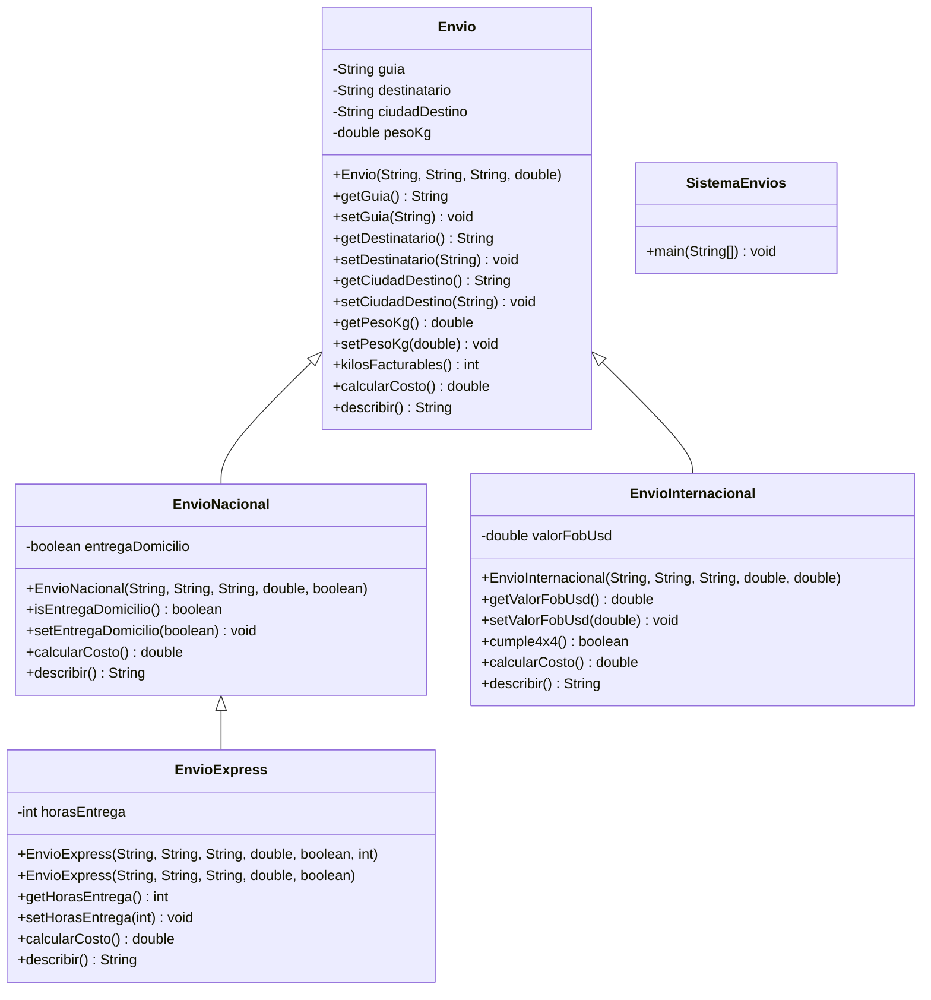

# Escuela Politécnica Nacional - EPN  
# Escuela de Formación de Tecnólogos - ESFOT 
## Sistema de Envíos Servientrega - POO en Java
> Estudiante: Melva Patricia Suarez C.  
> Asignatura: Programación Orientada a Objetos  
> Lenguaje: Java (JDK 21 o superior)  

## 🚚 Sistema de Envíos Servientrega - POO en Java

Este proyecto es una aplicación de consola desarrollada en Java que simula el sistema de gestión de envíos de la empresa **Servientrega**. Fue creado como solución a la prueba práctica de Programación Orientada a Objetos, aplicando conceptos avanzados como herencia multinivel, polimorfismo, encapsulamiento y manejo de colecciones.

## 📋 Descripción del Proyecto
El sistema permite a un empleado de mostrador registrar paquetes, calcular sus costos de envío según reglas de negocio específicas, consultar el estado de los paquetes en tránsito, marcarlos como entregados y generar un reporte diario de recaudación.

## 🚀 Características y Funcionalidades

A través de un menú interactivo en consola, el sistema ofrece las siguientes opciones:
1. **Registrar envío:** Permite ingresar envíos de tipo Nacional, Express o Internacional. Genera una guía única y calcula el costo.
2. **Consultar envío:** Busca un paquete en tránsito mediante su número de guía y muestra su información detallada.
3. **Entregar envío:** Cambia el estado del paquete de "en tránsito" a "entregado" y lo mueve al historial.
4. **Listar entregados:** Muestra todos los paquetes entregados en la sesión y calcula el total de dinero recaudado.
5. **Salir:** Finaliza la ejecución del programa.

## 📚 Conceptos de POO Aplicados

*   **Encapsulamiento:** Todos los atributos de las clases son privados y se acceden mediante métodos `get` y `set`, con validaciones lógicas (ej. evitar pesos menores o iguales a cero).
*   **Herencia Multinivel:**
*   `Envio` (Clase base) → `EnvioNacional` → `EnvioExpress`.
*   `Envio` → `EnvioInternacional`.
*   **Sobrescritura de Métodos:** Los métodos `calcularCosto()` y `describir()` son redefinidos en cada subclase para adaptarse a sus propias reglas.
*   **Sobrecarga de Constructores:** La clase `EnvioExpress` cuenta con dos constructores: uno que recibe las horas de entrega y otro que asigna `48` horas por defecto.
*   **Polimorfismo:** Uso de colecciones genéricas (`HashMap` para tránsito y `ArrayList` para entregados) que almacenan objetos de la clase base `Envio` pero ejecutan el comportamiento específico de las clases hijas.
*   **Conversiones de Tipo (Casting):** Uso de conversión explícita a `int` para calcular los kilos facturables y `String.valueOf()` para la generación de guías.

## ⚙️ Reglas de Negocio Implementadas

*   **Guías únicas:** Prefijos `NAC` (Nacional), `EXP` (Express) e `INT` (Internacional), seguidos de un contador global que inicia en `1001`. Los envíos rechazados no consumen número de guía.
*   **Kilos facturables:** Se cobra por kilo completo. Si el paquete pesa 2.3 kg, se cobran 3 kg.
*   **Tarifas:**
*   *Nacional:* $2.00 por kilo facturable + $1.50 si es entrega a domicilio.
*   *Express:* Costo de envío nacional + 40% de recargo.
*   *Internacional:* $6.00 por kilo facturable + $20.00 de arancel de aduana.
*   **Regla 4x4 (Aduana):** Los envíos internacionales solo se aceptan si pesan **4 kg o menos** y su valor FOB es de **$400 dólares o menos**. De lo contrario, son rechazados automáticamente.

## 🗂️ Estructura del Proyecto
```text
sistemaEnvios-poo/
├── src/
│   ├── Envios/
│   │   ├── Envio.java
│   │   ├── EnvioExpress.java
│   │   ├── EnvioInternacional.java
│   │   └── EnvioNacional.java
│   └── SistemaEnvios.java
├── .gitignore
└── README.md
```
## 💻 Cómo Ejecutar el Proyecto

### 1. Requisitos Previos
Antes de ejecutar el proyecto, asegúrate de tener instalado:
*   **Java JDK** (versión 8 o superior, recomendado JDK 17).
*   **Un IDE** como IntelliJ IDEA (recomendado), Eclipse o VS Code.
*   **Git** (opcional, solo si vas a clonar el repositorio).

### 2. Opción A: Ejecutar desde IntelliJ IDEA
1. Abre IntelliJ IDEA.
2. En la pantalla de bienvenida, haz clic en **Open** (o `File > Open` si ya tienes un proyecto abierto).
3. Selecciona la carpeta raíz del proyecto (`sistema-envios-servientrega`) y haz clic en **OK**.
4. Espera a que IntelliJ indexe los archivos y configure el SDK de Java.
5. En el panel de la izquierda (Project), navega hasta: `src > SistemaEnvios.java`.
6. Haz clic derecho sobre el archivo `SistemaEnvios.java` y selecciona **Run 'SistemaEnvios.main()'** (o presiona `Shift + F10`).
7. La consola integrada se abrirá en la parte inferior con el menú del sistema listo para usarse.

### 3. Opción B: Ejecutar desde la Terminal (Línea de Comandos)
Si no tienes un IDE o prefieres usar la consola, sigue estos pasos:
1. Abre tu terminal (CMD, PowerShell, o Terminal de Linux/Mac).
2. Navega hasta la carpeta raíz del proyecto:
   ```bash
   cd ruta/a/tu/carpeta/sistema-envios-servientrega
##  Diagrama UML

## 📸 Evidencias de Ejecución

A continuación se presentan las capturas de pantalla que demuestran el correcto funcionamiento del sistema, abarcando los casos de prueba solicitados en el enunciado.

| Funcionalidad / Caso | Descripción | Captura de Pantalla |
| :--- | :--- | :--- |
| **Menú Principal** | Visualización del menú y validación de opción inválida. | *(Insertar imagen aquí)* |
| **Registro Nacional** | Caso 1 y 2: Envíos nacionales con y sin domicilio. | *(Insertar imagen aquí)* |
| **Registro Express** | Caso 3 y 4: Envíos express (24h y 48h por defecto). | *(Insertar imagen aquí)* |
| **Registro Internacional** | Caso 5: Envío internacional válido (Guía INT1005). | *(Insertar imagen aquí)* |
| **Rechazo 4x4** | Casos 6 y 7: Rechazo por peso > 4kg o valor > $400. | *(Insertar imagen aquí)* |
| **Consultas** | Caso 9 y 10: Consulta exitosa y consulta de guía inexistente. | *(Insertar imagen aquí)* |
| **Entrega y Recaudación** | Caso 11 y 12: Entrega de envíos, total recaudado y consulta de entregado. | *(Insertar imagen aquí)* |

## 🛠️ Tecnologías Utilizadas
*   **Lenguaje:** Java (JDK 21 o superior).
*   **IDE Recomendado:** IntelliJ IDEA / Eclipse / VS Code.
*   **Control de Versiones:** Git y GitHub.
<br>
---
> ***Autora:** Melva Suarez*  
> ***Link del repositorio:** [Corrección Examen POO](https://github.com/MelvaSuarez29/sistema-envios-servientrega.git)*  
> *El siguiente proyecto fue realizado con fines académicos, como corrección del Examen 1 del primer bimestre de la materia de Programación Orientada a Objetos.*